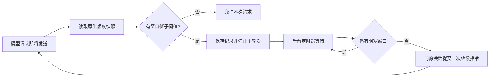

# Claude Capacity Guard

[English](README.en.md) · 简体中文

为保持打开的 Claude Code 交互式会话增加额度守卫：剩余额度低于阈值时暂停，额度窗口可用后，在原会话自动提交一次继续指令。

默认阈值为 **剩余 10%**，重置后缓冲 **60 秒**，等待期间每 **30 秒**检查原生额度快照，自动发送的文本默认为 **`continue`**。通过 Claude Code Mods API 实现，无需单独的 API Key、OAuth 凭据读取或用量查询服务。

## 安装

在系统终端执行：

```bash
claude plugin marketplace add whiteCcinn/claude-capacity-guard
claude plugin install capacity-guard@claude-capacity-guard
```

已有 Claude 会话运行 `/reload-plugins`，或重新打开会话。验证基线是 **Claude Code 2.1.325**；其他版本和界面见[兼容性说明](docs/compatibility.md)。

| 标识 | 名称 |
| --- | --- |
| GitHub 项目 / marketplace | `claude-capacity-guard` |
| 插件名 | `capacity-guard` |
| 完整安装 ID | `capacity-guard@claude-capacity-guard` |
| 源码加载配置 ID | `capacity-guard@inline` |

## 使用和配置

在 Claude 会话中输入：

```text
/capacity
/capacity cancel
/plugin configure capacity-guard@claude-capacity-guard
```

`/capacity` 查看额度快照及等待状态，`/capacity cancel` 取消本次自动恢复。接受新的用户消息也会取消旧任务的恢复记录；如果额度仍低，新任务会重新触发暂停。取消等待不等于关闭守卫，持续关闭请修改 `enabled` 或禁用插件。

| 配置 | 默认值 | 作用 |
| --- | --- | --- |
| `enabled` | `true` | 启用额度检查 |
| `remaining_threshold` | `10` | 剩余百分比严格低于阈值时暂停，范围 0–99；0 表示耗尽时暂停 |
| `reset_buffer_seconds` | `60` | 在重置时间后额外等待 1–3600 秒 |
| `check_interval_seconds` | `30` | 每 5–300 秒检查原生缓存，不主动刷新服务器额度 |
| `resume_text` | `continue` | 自动恢复时发送的完整文本，可改为“继续”或自定义指令 |

例如设为 `20`，剩余低于 20% 时暂停，恰好 20% 时允许请求。保存配置后按提示重新加载插件。命令行配置、更新、卸载见[配置文档](docs/configuration.md)。

在配置中的「自动继续文本」填写 `continue` 或“继续”，插件恢复时就发送该文本，不附加原来的长提示。它控制自动发出的内容，不是对外部消息增加一套关键词匹配规则。

## 工作原理



检查的是 `$.session.usage().rateLimits` 中的 `percentUsed`、`kind` 和 `resetsAt`，不是上下文窗口占用或本地 token 累计。所有已报告的额度窗口都会参与判断。若短周期和周额度同时不足，就等待较晚的重置时间加缓冲；新读数显示额度已足够时也可提前恢复。

暂停会结束当前主轮次。继续时，Claude 根据原有会话历史、工具结果和文件改动接着执行。插件不重放工具调用，也不会在有执行预算的钩子里等待几个小时。[架构文档](docs/architecture.md)解释状态机、并发控制和错误处理。

## 适用范围

- **自动恢复要求交互式会话保持运行**。关闭进程、关机或重新打开会话后，需要检查进度并手动继续。`claude -p` / SDK 不提供进程退出后的自动恢复。
- **额度是最近一次响应的快照**。首次没有读数时允许原生请求；暂停后读数为空或读取失败则继续等待。重置时间经过后允许一次恢复尝试，不能保证其他会话没有再次消耗额度。
- **Agent Teams 只有部分覆盖**。同进程且能被钩子观察到的成员请求会被检查；本版只自动续接主会话，不承诺整个队伍同步暂停或逐成员恢复。分屏成员需要各自加载插件，详见[集成边界](docs/integrations.md)。
- **不能保证外部操作恰好执行一次**。已经发送的请求可能完成，工具也可能被中止。可在自定义继续指令中要求核对已有结果，仍需任务本身具备幂等性或人工核对机制。

与 `interaction-translator` 0.7.0 共用时，自动继续消息带有 `plugin` 来源，因此跳过它的输入翻译；后续回复仍受输出翻译设置影响。[集成说明](docs/integrations.md)包含源码依据与验证方法。

## 文档

| 文档 | 内容 |
| --- | --- |
| [架构与原理](docs/architecture.md) | 额度计算、状态机、暂停和恢复流程 |
| [配置与安装管理](docs/configuration.md) | 参数、命令行示例、更新和卸载 |
| [日常使用](docs/usage.md) | 等待、取消、手动恢复与示例 |
| [翻译插件与 Agent Teams](docs/integrations.md) | 互操作行为和支持边界 |
| [兼容性与验证范围](docs/compatibility.md) | 已验证环境与未验证能力 |
| [故障排查](docs/troubleshooting.md) | 没有读数、不恢复、仍然限流等问题 |
| [开发与测试](docs/development.md) | 项目结构、原生测试、类型检查与流程测试 |
| [贡献指南](CONTRIBUTING.md) | 提交改动、规格、测试和发布约定 |
| [安全政策](SECURITY.md) | 数据访问、信任与漏洞报告 |
| [变更记录](CHANGELOG.md) | 版本变化 |

## 开发

```bash
git clone https://github.com/whiteCcinn/claude-capacity-guard.git
cd claude-capacity-guard
claude plugin validate . --strict
claude plugin validate plugins/capacity-guard --strict
claude plugin test plugins/capacity-guard
```

无需 npm 运行时依赖。自动测试模拟额度、时间、存储和模型调用，不需要真实模型请求；开发类型由本机 Claude Code 生成。完整步骤见[开发文档](docs/development.md)。

## 致谢与许可

插件布局与原生配置方式参考 [claude-interaction-translator](https://github.com/whiteCcinn/claude-interaction-translator)。守卫可独立运行，不依赖翻译插件。[MIT License](LICENSE)。
