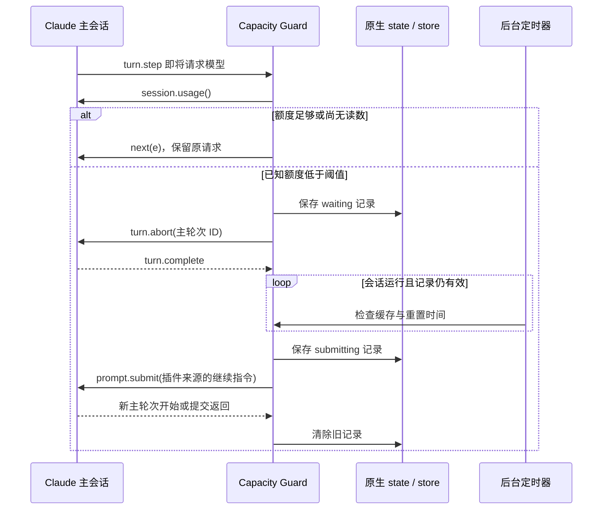
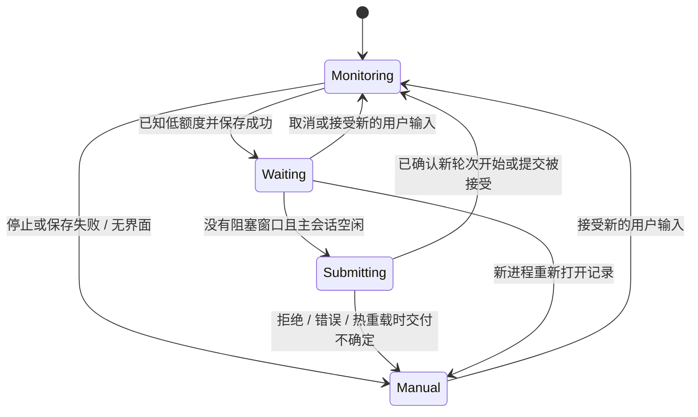

# 架构与工作原理

[返回 README](../README.md)

额度守卫在模型请求边界决定是否放行。暂停记录保留在 Claude 原生状态中；定时器负责等待；恢复通过原会话的新轮次继续。它不冻结操作系统进程，也不在插件中复制任务执行器。

## 额度来源与判断

`turn.step` 表示一次即将发送的模型请求。守卫先调用 `$.session.usage()`，读取 `rateLimits` 数组：

| 字段 | 含义 |
| --- | --- |
| `kind` | 额度窗口名称，例如 `five_hour`、`seven_day`，或网关提供的 `spend_limit` |
| `percentUsed` | 已使用百分比；超额的网关窗口可能超过 100 |
| `resetsAt` | 可选的 ISO 8601 重置时间 |

正常读数的剩余比例为 `100 - percentUsed`。未经过重置缓冲的窗口，满足以下任一条件就会阻塞：

```text
percentUsed >= 100
或
100 - percentUsed < remaining_threshold
```

比较是严格小于，因此阈值 10 时，剩余恰好 10% 可放行。阈值 0 时仍会拦截耗尽或超额的窗口。非有限或负的使用比例会被过滤，不会作为健康读数。

读取的是最近一次响应带来的快照，调用本身不主动查询新的服务器用量。已知窗口的重置时间加缓冲经过后，旧读数不再阻塞，允许尝试恢复；这不证明账号此刻有多少可用额度。API Key 和其他服务如果未提供窗口，首次空读数不能用于百分比保护，会交由 Claude 原生机制处理。

## 多窗口等待

所有已报告的窗口都会参与判断，不根据当前模型猜测应该忽略哪种窗口。阻塞窗口都有有效时间时：

```text
resumeAt = max(各阻塞窗口的 resetsAt) + reset_buffer_seconds
```

例如五小时窗口 15:00 重置，周窗口周一 08:00 重置，两者均不足时，等待到周一 08:00 加缓冲。只要一个阻塞窗口缺少有效时间，就不虚构统一恢复时间，而是继续等待读数变化。

等待期间将先前阻塞窗口与当前有效窗口按 `kind` 合并，防止较新的部分读数误删仍不足的周额度。新读数显示某窗口额度足够时，可以解除它的阻塞；因此恢复不一定要等到旧的预估时间。

## 生命周期



恢复消息使用配置 `resume_text`，默认只有 `continue`。去除首尾空白后将完整文本交给 `$.prompt.submit`，不附加隐藏指令；若需要核对已有工具结果或文件改动，可以把要求写入自定义文本。任务正文和历史仍由 Claude 保存，守卫没有自己的提示词队列，也不重发旧工具调用。

宿主给每个钩子有限的执行预算，`clock.sleep` 等待会计入预算。因此长时间等待由 `clock.every` 的独立回调承担，不占用一个挂起数小时的 `turn.step` 钩子。[原生限制参考](https://code.claude.com/docs/en/plugins/mods/reference.md#limits)。

## 状态机与记录



`Monitoring` 表示没有待恢复记录，不是持久化的 phase。其余三个阶段为 `waiting`、`submitting`、`manual`。

| 记录字段 | 用途 |
| --- | --- |
| `version`、`sessionId` | 校验格式并隔离会话 |
| `token`、`turnId` | 标识本次暂停及所属主轮次 |
| `pausedAt`、`resumeAt` | 暂停和预估恢复时间 |
| `windows` | 最多 32 个相关窗口 |
| `phase`、`note` | 等待、提交、手动恢复与说明 |

不保存任务提示词、聊天正文、工具输出或凭据。原生 `state` 支持当前会话的热重载，插件 `store` 用 `pause:<sessionId>` 键持久化记录。新进程没有原有 live state 的所有权，因此磁盘中的等待记录会转为手动，避免意外启动旧工作。

继续文本属于原生配置，不写入暂停记录。热重载恢复等待时，使用新模块读取到的配置文本；0.1.1 没有更改暂停记录格式。

## 并发与失败处理

- `pausing` 在异步保存前占有暂停流程，避免主任务与子任务重复创建记录。
- `busy` 防止定时器回调重叠；主轮次仍运行或用户输入尚未决定是否接受时，不提交继续指令。
- `epoch` 在取消、切换和新所有权建立时递增，让旧的异步结果失效。
- `persist` 串行写 live state 和持久记录。取消写入的空记录必须位于旧写入之后，避免旧结果复活。
- 提交前先保存 `submitting`。热重载或异常时不能确认交付，就转为 `manual`，不自动重试。
- 新主轮次开始即释放旧提交记录，确保恢复后立即发现低额度时能建立新暂停；旧提交的完成回调不能清掉新记录。
- 守卫自己引起的主轮次中断保留等待；用户的新中断和接受的新输入撤销旧等待。空闲时按 Esc 未必产生中断事件，应使用 `/capacity cancel`。

已有暂停期间，空读数、无效读数和读取失败不会作为恢复证据。保存或停止无法确认时转为手动。请求边界以外的工具可能已经执行，无法通过状态机撤销其副作用。

## 代码位置与边界

| 文件 | 职责 |
| --- | --- |
| [policy.ts](../plugins/capacity-guard/hooks/policy.ts) | 参数归一化、有效读数、阈值与重置计算 |
| [checkpoint.ts](../plugins/capacity-guard/hooks/checkpoint.ts) | 持久化记录校验和窗口合并 |
| [register.ts](../plugins/capacity-guard/hooks/register.ts) | 钩子、计时器、保存、命令和恢复所有权 |
| [types/index.d.ts](../plugins/capacity-guard/types/index.d.ts) | 自包含原生 state 契约 |

子任务和 Agent Teams 的请求能否被当前会话观察，取决于宿主执行方式。一个主会话的暂停记录不代表全队状态；详细边界见[集成文档](integrations.md)。

宿主 API 以本机生成的声明为准，公开资料见 [Mods reference](https://code.claude.com/docs/en/plugins/mods/reference.md) 和 [Mods API](https://code.claude.com/docs/en/plugins/mods/api.md)。测试证据见[兼容性说明](compatibility.md)。
